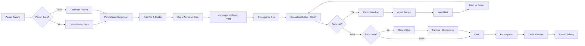
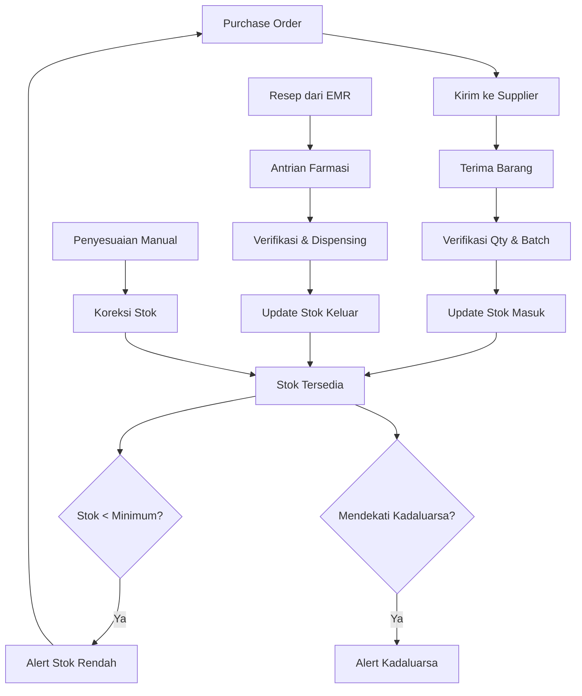
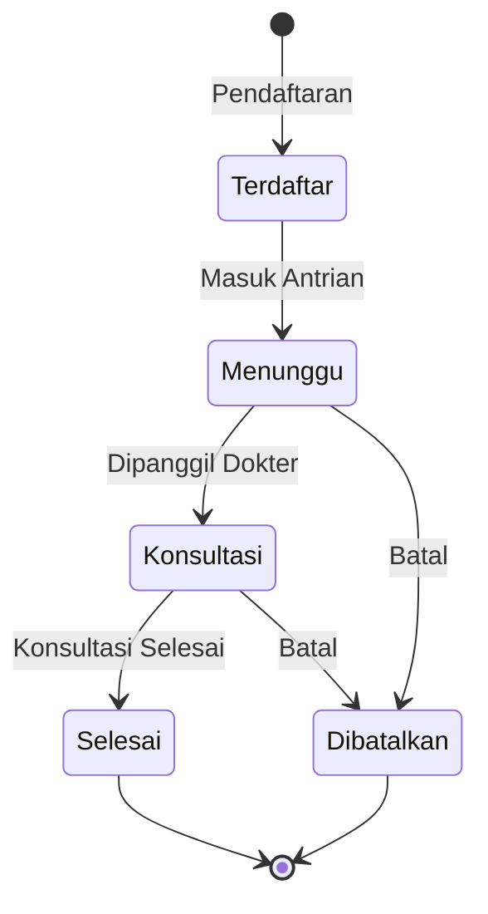
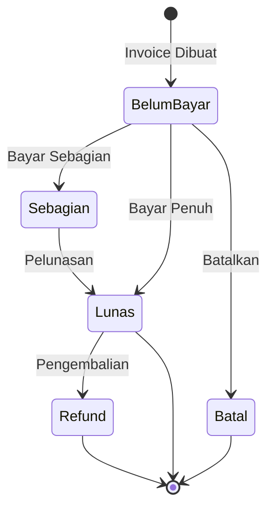
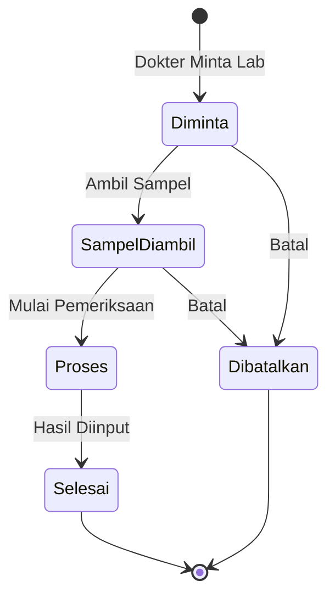
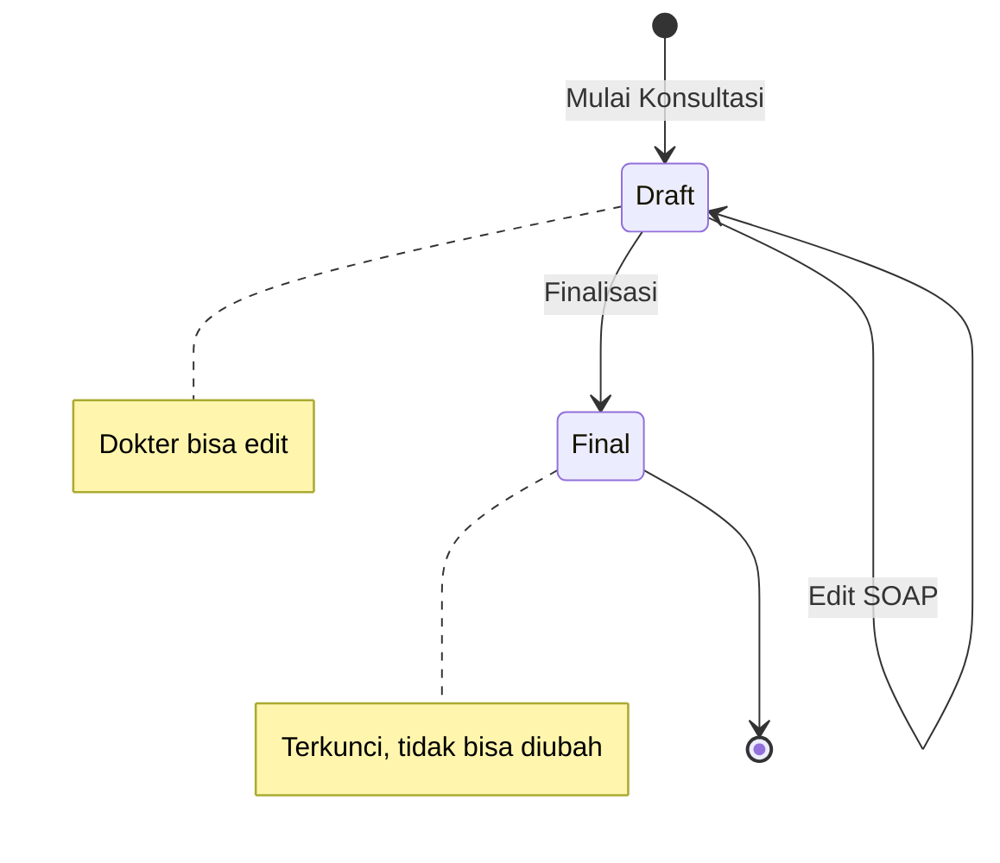
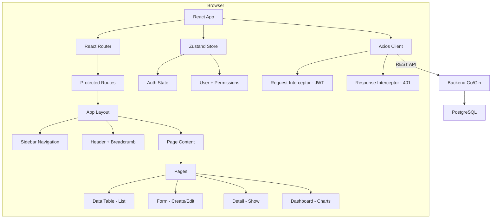
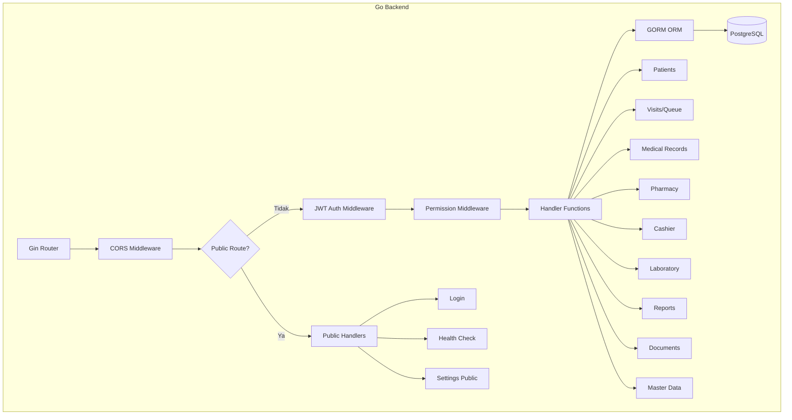

# SIMKLINIK — Entity Relationship Diagram

## Diagram Relasi Entitas (ERD)

Diagram ini menunjukkan seluruh tabel dan relasi antar entitas dalam sistem SIMKLINIK.

---

### ERD Lengkap

```mermaid
erDiagram
    %% ========== MASTER DATA ==========
    Polyclinic {
        uint ID PK
        string Name
        string Code UK
        string Description
        bool IsActive
        string Color
        string Icon
        int SortOrder
    }

    Doctor {
        uint ID PK
        uint UserID FK
        string FullName
        string SIPNumber
        string Specialization
        string Phone
        string Photo
        bool IsActive
    }

    DoctorSchedule {
        uint ID PK
        uint DoctorID FK
        uint PolyclinicID FK
        int DayOfWeek
        time StartTime
        time EndTime
        int MaxPatients
        bool IsActive
    }

    ICD10 {
        uint ID PK
        string Code UK
        string Name
        string NameID
        string Category
        string Chapter
    }

    Medicine {
        uint ID PK
        string Code UK
        string Name
        string GenericName
        uint CategoryID FK
        uint UnitID FK
        string Type
        string Form
        string Strength
        string Manufacturer
        int MinStock
        int CurrentStock
        float PurchasePrice
        float SellingPrice
        bool IsActive
    }

    MedicineCategory {
        uint ID PK
        string Name
        string Description
    }

    Unit {
        uint ID PK
        string Name
    }

    MedicalService {
        uint ID PK
        string Code
        string Name
        uint CategoryID FK
        uint PolyclinicID FK
        float Price
        bool IsActive
    }

    ServiceCategory {
        uint ID PK
        string Name
    }

    PaymentMethod {
        uint ID PK
        string Name
        bool IsActive
    }

    Supplier {
        uint ID PK
        string Name
        string ContactPerson
        string Phone
        string Email
        string Address
        bool IsActive
    }

    %% ========== FRONT OFFICE ==========
    Patient {
        uint ID PK
        string MedicalRecordNumber UK
        string NIK UK
        string FullName
        date BirthDate
        string BirthPlace
        string Gender
        string BloodType
        string Phone
        string Address
        string InsuranceType
        string Allergies
        bool IsActive
    }

    Visit {
        uint ID PK
        string VisitNumber UK
        uint PatientID FK
        date VisitDate
        uint PolyclinicID FK
        uint DoctorID FK
        int QueueNumber
        string QueueStatus
        string PaymentType
        string Complaint
        string VisitType
        string Priority
        string Status
        uint RegisteredBy FK
    }

    QueueCounter {
        uint ID PK
        uint PolyclinicID FK
        date Date
        int LastNumber
    }

    %% ========== EMR ==========
    MedicalRecord {
        uint ID PK
        uint VisitID FK
        uint PatientID FK
        uint DoctorID FK
        uint PolyclinicID FK
        date RecordDate
        text Subjective
        int BPSystolic
        int BPDiastolic
        int HeartRate
        float Temperature
        int RespiratoryRate
        float SpO2
        float Height
        float Weight
        float BMI
        text PhysicalExamination
        text Assessment
        text Plan
        string Status
    }

    MedicalRecordDiagnosis {
        uint ID PK
        uint MedicalRecordID FK
        uint ICD10ID FK
        string DiagnosisType
        text Notes
    }

    Prescription {
        uint ID PK
        uint MedicalRecordID FK
        uint MedicineID FK
        int Quantity
        string Dosage
        string Frequency
        string Duration
        string Route
        string Instructions
        string Status
    }

    MedicalAction {
        uint ID PK
        uint MedicalRecordID FK
        uint MedicalServiceID FK
        uint DoctorID FK
        text Notes
        int Quantity
        float Price
    }

    InformedConsent {
        uint ID PK
        uint MedicalRecordID FK
        uint PatientID FK
        uint DoctorID FK
        string ActionName
        text ActionDescription
        text Risks
        text Benefits
        string PatientDecision
        date ConsentDate
        string WitnessName
    }

    %% ========== FARMASI ==========
    StockMovement {
        uint ID PK
        uint MedicineID FK
        string Type
        int Quantity
        int PreviousStock
        int NewStock
        string ReferenceType
        uint ReferenceID
        string BatchNumber
        date ExpiryDate
        uint CreatedBy FK
    }

    PurchaseOrder {
        uint ID PK
        string PONumber UK
        uint SupplierID FK
        date OrderDate
        date ReceivedDate
        string Status
        float TotalAmount
        uint CreatedBy FK
    }

    PurchaseOrderItem {
        uint ID PK
        uint PurchaseOrderID FK
        uint MedicineID FK
        int Quantity
        int ReceivedQuantity
        float UnitPrice
        float TotalPrice
        string BatchNumber
        date ExpiryDate
    }

    Dispensing {
        uint ID PK
        uint VisitID FK
        uint PrescriptionID FK
        uint MedicineID FK
        int Quantity
        string BatchNumber
        uint DispensedBy FK
        datetime DispensedAt
        string Status
    }

    %% ========== BILLING ==========
    Invoice {
        uint ID PK
        string InvoiceNumber UK
        uint VisitID FK
        uint PatientID FK
        date InvoiceDate
        float SubTotal
        float Discount
        string DiscountType
        float Tax
        float TotalAmount
        string Status
        uint CreatedBy FK
    }

    InvoiceItem {
        uint ID PK
        uint InvoiceID FK
        string ItemType
        uint ReferenceID
        string Description
        int Quantity
        float UnitPrice
        float Discount
        float TotalPrice
    }

    Payment {
        uint ID PK
        uint InvoiceID FK
        uint PaymentMethodID FK
        float Amount
        date PaymentDate
        string ReferenceNumber
        uint ReceivedBy FK
    }

    %% ========== LABORATORIUM ==========
    LabTest {
        uint ID PK
        string Code
        string Name
        uint CategoryID FK
        string Unit
        string NilaiNormalPria
        string NilaiNormalWanita
        float Price
        bool IsActive
    }

    LabTestCategory {
        uint ID PK
        string Name
    }

    LabRequest {
        uint ID PK
        string RequestNumber UK
        uint MedicalRecordID FK
        uint PatientID FK
        uint DoctorID FK
        date RequestDate
        string Type
        string ExternalLabName
        string Status
        string Priority
    }

    LabRequestItem {
        uint ID PK
        uint LabRequestID FK
        uint LabTestID FK
        string Result
        string Unit
        string NormalValue
        string Flag
        date ResultDate
        uint ResultBy FK
    }

    %% ========== RELASI ==========
    Doctor ||--o{ DoctorSchedule : "jadwal"
    Polyclinic ||--o{ DoctorSchedule : "jadwal"
    Doctor }o--o{ Polyclinic : "praktik di"

    MedicineCategory ||--o{ Medicine : "kategori"
    Unit ||--o{ Medicine : "satuan"
    ServiceCategory ||--o{ MedicalService : "kategori"
    Polyclinic ||--o{ MedicalService : "layanan"

    Patient ||--o{ Visit : "kunjungan"
    Polyclinic ||--o{ Visit : "tujuan"
    Doctor ||--o{ Visit : "dokter"
    Polyclinic ||--o{ QueueCounter : "antrian"

    Visit ||--|| MedicalRecord : "rekam medis"
    Patient ||--o{ MedicalRecord : "riwayat"
    Doctor ||--o{ MedicalRecord : "penulis"
    MedicalRecord ||--o{ MedicalRecordDiagnosis : "diagnosis"
    ICD10 ||--o{ MedicalRecordDiagnosis : "kode"
    MedicalRecord ||--o{ Prescription : "resep"
    Medicine ||--o{ Prescription : "obat"
    MedicalRecord ||--o{ MedicalAction : "tindakan"
    MedicalService ||--o{ MedicalAction : "layanan"
    MedicalRecord ||--o{ InformedConsent : "consent"

    Medicine ||--o{ StockMovement : "pergerakan"
    Supplier ||--o{ PurchaseOrder : "pesanan"
    PurchaseOrder ||--o{ PurchaseOrderItem : "item"
    Medicine ||--o{ PurchaseOrderItem : "obat"
    Visit ||--o{ Dispensing : "dispensing"
    Medicine ||--o{ Dispensing : "obat"

    Visit ||--|| Invoice : "tagihan"
    Patient ||--o{ Invoice : "tagihan"
    Invoice ||--o{ InvoiceItem : "item"
    Invoice ||--o{ Payment : "pembayaran"
    PaymentMethod ||--o{ Payment : "metode"

    LabTestCategory ||--o{ LabTest : "kategori"
    MedicalRecord ||--o{ LabRequest : "permintaan lab"
    Patient ||--o{ LabRequest : "lab"
    LabRequest ||--o{ LabRequestItem : "item"
    LabTest ||--o{ LabRequestItem : "tes"
```

---

### Alur Pasien Rawat Jalan

---

### Alur Manajemen Stok

---

### Status Antrian

---

### Status Invoice

---

### Status Permintaan Lab

---

### Status Rekam Medis

---

### Arsitektur Frontend

---

### Arsitektur Backend

